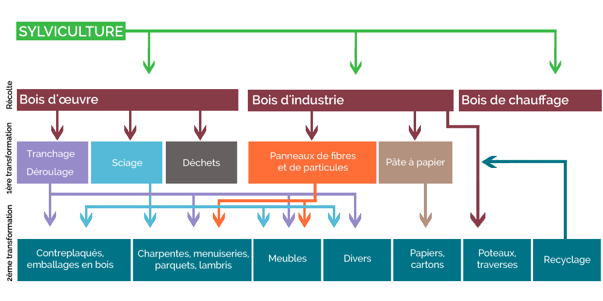

# 🪵 Composants en bois

## Généralités

Les composants en bois sont ceux majoritairement utilisés dans l'industrie du meuble (61% des meubles mis sur le marché en 2022 sont majoritairement constitués de bois -source[^1]-).

Les composants en bois proposées dans Ecobalyse sont issues de bois d'oeuvre ayant subis plusieurs étapes de transformation :&#x20;

1. Sylviculture : consiste à gérer les forêts (dont un des objectifs est de produire du bois),
2. Première transformation : consiste à exploiter le bois en forêt et à le débiter en scierie de telle sorte qu'il soit ensuite transformés selon les débouchés (ameublement, bâtiment, etc.),&#x20;
3. Deuxième transformation : consiste à conférer de la valeur ajoutée aux bois et à le rendre exploitable pour le consommateur final.&#x20;

<figure><figcaption>
Schéma simplifié du cycle de vie du bois d'oeuvre 
</figcaption></figure>

## Modélisation Ecobalyse

Deux types de composants en bois sont proposés dans Ecobalyse :&#x20;

* les planches de bois (feuillus vs résineux),
* les panneaux (contrplaqué, OSB, etc.).

L'ensemble des étapes amont nécessaires à la production de ces composants (ex : consommation d'énergie en scierie, taux de pertes en scierie, technique de séchage utilisée, modes de gestion des forêts, etc.) sont inclues dans ces procédés. &#x20;

Illustration

Production 1kg de planche de feuillus : &#x20;

* procédé Ecoinvent : _market for sawnwood, board, hardwood, dried (u=10%), planed (RER)_
* Etapes inclues dans le procédé :&#x20;
  * sylviculture,
  * sciage,
  * séchage,
  * rabotage.

### Procédés disponibles dans Ecobalyse :&#x20;

cf. l'Explorateur pour accéder à la liste des composant en bois disponibles dans Ecobalyse.&#x20;

<figure><figcaption></figcaption></figure>

Focus sur les résines et colles utilisées dans les panneaux (aggloméré, MDF, etc.)

Les principales résines synthétiques utilisées dans les panneaux pour maintenir les fibres/particules de bois ensemble et permettre au panneau d'acquérir les propriétés souhaitées sont :&#x20;

* l'urée formaldéhyde (UF),
* l'urée-formaldéhyde mélaminique (MUF),&#x20;
* le phénol-formaldéhyde (PF),
* l'urée-mélamine-phénol-formaldéhyde (UMPF),
* les composés isocyanate et isocyanates

[^1]: Bilan annuel 2022 _Filière des éléments d'ameublement_ Ademe
