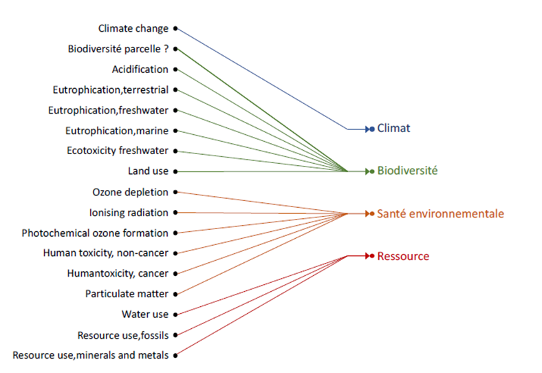

# 📝 Le coût environnemental : approche méthodologique globale (old)

Le coût environnemental est le résultat du calcul d'impacts selon la méthode de l'Etat français. Cette méthode s'appuie sur le socle européen PEF (Product Environmental Footprint), auxquels s'ajoutent des compléments relatifs aux dimensions aujourd'hui mal couvertes par l'analyse de cycle de vie.

$$
Coût Environnemental = impacts ACVcorrigés +compléments HorsACV
$$

## Unité du coût environnemental

Le coût environnemental est exprimé en points d'impacts. Ce point d'impact a été créé par analogie avec le "point PEF" (qui lui correspond à l'impact environnemental annuel d'un habitant européen), mais en est distinct.

Pour une meilleure lisibilité des résultats, on définie l'impact d'un habitant européen à 1 MPts (mégapoints) d'impacts soit 1 000 000 Pt (points) d'impact. Ainsi 1 Pt d'impact correspond à 1 millionième de l'impact annuel d'un habitant européen.

* 1 MPts (mégapoint d'impact) = 1 000 000 Pt (points d'impact)
* 1 Pt (point d'impact) = 10^-6 MPts (mégapoints d'impact)

## Indicateurs ACV et correctifs

### Impacts agrégés et impacts détaillés

Ecobalyse permet de visualiser **2 impacts agrégés**, c'est à dire regroupant différents impacts après normalisation et pondération :

* le **coût environnemental**, qui traduit le calcul d'impacts selon la méthode de l'Etat français ; donc en ajustant les pondérations PEF et en ajoutant quelques indicateurs complémentaires.
* un **score "pondération PEF"** tel que défini dans la [recommandation de la Commission européenne du 16 décembre 2021](https://eur-lex.europa.eu/legal-content/EN/TXT/?uri=PI_COM%3AC%282021%299332) sur l'utilisation des méthode d'évaluation des empreintes environnementales. Ce score applique uniquement les indicateurs PEF avec leurs pondérations initiales. A noter qu'il n'a pas été possible d'utiliser les données EF à ce stade pour des raisons de propriété intellectuelle.

**Le détail des catégories d'impacts ACV** peut également être consulté :

* Les 16 catégories d'impacts de la méthode PEF ([lien](./#16-categories-dimpacts-pef))
* La catégorie d'impact corrigée relative à l'écotoxicité (l[ien](./#indicateurs-de-toxicite-et-decotoxicite-corriges))


A terme, deux autres catégories d'impact ACV, relatives à la biodiversité marine et terrestre ("à la parcelle") sont susceptibles d'être introduites.


Les impacts sont ensuite agrégés suivant la **règle de l'affectation unique** introduite dans le rapport du Conseil scientifique. Chaque catégorie d'impacts est ainsi rattachée à la catégorie à laquelle elle contribue le plus.

<figure><figcaption>
Répartition des catégories suivant la règle de l'affectation unique
</figcaption></figure>

### Normalisations et pondérations

Les calculs de la partie ACV coût environnemental et du score PEF s'effectuent à partir d'une somme pondérée des catégories d'impacts, chacune étant préalablement normalisée.

$$
ImpactAgrégé =\sum (Pondération_i * \frac{Impact_i}{Normalisation_i})
$$

Les niveaux de normalisation et de pondération sont détaillés dans l'[explorateur des impacts pour l'alimentaire d'Ecobalyse](https://ecobalyse.beta.gouv.fr/#/explore/food).

Pour la construction du coût environnemental, **les mêmes coefficients de normalisation que ceux du score PEF** sont appliqués.

Pour la **pondération**, la méthode de l'affichage environnemental établit que :

* la pondération du changement climatique est maintenue à 21,06% ;
* la pondération de l'écotoxicité eau douce est réhaussée à 21,06% (détail des explications [ici](./#correction-des-indicateurs-de-toxicite-et-decotoxicite)) ;
* les pondérations des indicateurs de toxicité humaine cancer et non-cancer sont fixées à zéro, ce qui revient à supprimer ces indicateurs du coût environnemental (détail des explications [ici](./#correction-des-indicateurs-de-toxicite-et-decotoxicite))
* les autres pondérations sont proportionnelles aux pondérations PEF initiales, mais réduite afin que la somme des pondérations reste bien à 100% après l'introduction des trois modifications précédentes.


Cette règle est une des deux options introduites dans le rapport du Conseil scientifique.


### Correctifs sur la toxicité et d'écotoxicité

La modélisation des impacts de toxicité humaine (toxicité humaine cancer et toxicité humaine non-cancer) dans la méthode PEF n'est aujourd'hui pas satisfaisante. Dans l'attente de consolider ces deux indicateurs, il est proposé de les supprimer dans le calcul du coût environnemental.

En revanche, l'indicateur d'écotoxicité (écotoxicité eau douce), est lui considéré comme plus robuste par la communauté scientifique, bien que partiel puisque ne prend pas en compte l'ensemble des impacts écotoxiques, notamment sur les milieux terrestres. Par ailleurs, l'absence d'un indicateur de "biodiversité locale" dans le cadre ACV actuellement justifie de considérer temporairement cet indicateur d'écotoxicité comme un "proxy" de la biodiversité locale. Il est donc proposé de réhausser sa pondération à hauteur de 21%, c'est-à-dire au même niveau que l'impact changement climatique.

Pour les produits textiles, il est également proposé d'enrichir les inventaires de l'étape [Ennoblissement](../../../textile/cycle-de-vie-des-produits-textiles/ennoblissement/) afin de mieux prendre en compte l'impact des substances chimiques mobilisées lors du traitement des fibres (plus de détails dans la [partie dédiée](../../../textile/cycle-de-vie-des-produits-textiles/ennoblissement/inventaires-enrichis.md)).

## Compléments hors ACV

Pour les produits textiles comme pour les produits alimentaires, le socle PEF, sur lequel la méthode de l'Etat français est fondée, est complété pour prendre en compte des dimensions aujourd'hui mal couvertes par l'ACV.

Pour les _**produits textiles**_, ces dimensions concernent :

* L'[**export hors Europe**](../../../textile/complements-hors-acv/export-hors-europe.md) des vêtements en fin de vie : une part non négligeable (9%) des vêtements sont exportés hors Europe et retrouvés sous forme de déchets dans de nombreux pays (e.g. Ghana, Kenya, Afghanistan, Antilles, etc.). Ces pays ne bénéficiant généralement pas d'une filière structurée de gestion des déchets textiles, ceci est à l'origine de nombreux problèmes environnementaux et sanitaires. Le complément proposé vise à prendre en compte l'impact de cet export hors Europe, que les modélisations ACV telles que le projet de PEFCR Apparel & Footwear (v1.3) n'intègrent pas aujourd'hui.
* Les [**microfibres**](../../../textile/complements-hors-acv/microfibres.md) : de plus en plus considérés au regard des préoccupation croissantes sur les impacts des microplastiques, le complément propose de prendre en compte l'impact des microfibles relarguées dans l'environnement, aujourd'hui non intégré dans les référentiels d'ACV existants tels que le projet de PEFCR Apparel & Footwear (v1.3). Ces microfibres peuvent être plus ou moins persistantes (non biodégradables) et toxiques pour les organismes vivants.

Pour les _**produits alimentaires**_, ces compléments hors ACV visent à prendre en compte les **externalités environnementales positives de certains modes de production** telles que désignées dans l’[article 2 de la loi Climat et résilience](https://www.legifrance.gouv.fr/jorf/article_jo/JORFARTI000043956979). Ces externalités positives ne sont aujourd'hui pas intégrées à l'ACV. Pourtant, elles sont essentielles pour appréhender au mieux l'impact systémique de l'agriculture, notamment à l'échelle des territoires. En effet, les pratiques agricoles façonnent grandement les écosystèmes et les paysages, que ce soit en termes de biodiversité (maintien de zones refuges, de corridors écologiques, d'une mosaïque paysagère diversifiée, etc.) ou en termes de résilience face aux aléas divers (préservation contre l'érosion des sols, bouclage des cycles et moindre dépendance à certains nutriments exogènes, régulation naturelle des ravageurs de cultures, etc.). Ces compléments visent donc à prendre en compte ces effets.

## Durabilité

La [**durabilité**](../../../textile/durabilite.md) **non-physique des produits textiles** est intégrée au calcul au moyen d'un coefficient compris entre 0,67 et 1,45 (0,67 pour les produits les moins durables, et 1,45 pour les produits les plus durables), venant **moduler le coût environnemental** . Il vise à refléter la propension qu'a un vêtement à être porté plus longtemps en fonction d'autres critères : réparabilité, attachement...
