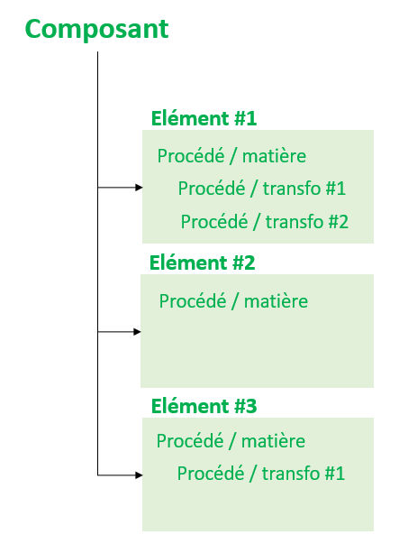

# 🧩 Production des matériaux (ou ingrédients)

## Vocabulaire, 3 lexiques à différencier

La construction de l'outil Ecobalyse, et en particulier la section relative aux matériaux (ou ingrédients) s'appuie sur un modèle de données structuré permettant d'exprimer une grande diversité de matériaux (ou ingrédients). Dans cette page, et dans la mesure du possible dans les autres pages de la documentation, on distingue 3 lexiques :&#x20;

* Le <mark style="color:green;">**modèle de données Ecobalyse**</mark> : un lexique transverse, utilisé pour désigner des objets au sens informatique du terme
* Une **traduction en anglais**, utilisée notamment dans le code source Ecobalyse et susceptible d'être mobilisée en cas d'utilisation de l'outil pour d'autres pays
* La <mark style="color:blue;">**présentation sur l'outil de calcul**</mark> : comment les différents objets sont libellés sur les différents calculateurs, avec la possibilité de changer ces libellés suivant les catégories de produits (ex : on parle de "matériaux" pour la verticale "Objets" et d' "ingrédients" pour la verticale "Alimentation").

| Modèle de données Ecobalyse                                | Traduction en anglais           | Présentation sur l'outil / Objets                 | Présentation sur l'outil / Alimentation           |
| ---------------------------------------------------------- | ------------------------------- | ------------------------------------------------- | ------------------------------------------------- |
| <mark style="color:green;">Composant</mark>                | component                       | <mark style="color:blue;">Matériau</mark>         | <mark style="color:blue;">Ingrédient</mark>       |
| <mark style="color:green;">Elément</mark>                  | element                         | <mark style="color:blue;">Sous-matériau</mark>    | <mark style="color:blue;">Sous-ingrédient</mark>  |
| <mark style="color:green;">Procédé / matière</mark>        | 
material raw material
 | <mark style="color:blue;">Matière première</mark> | <mark style="color:blue;">Matière première</mark> |
| <mark style="color:green;">Procédé / transformation</mark> | transformation                  | <mark style="color:blue;">Transformation</mark>   | <mark style="color:blue;">Transformation</mark>   |

## Contexte

La description d'un produit (objet, produit alimentaire, véhicule...) passe prioritairement par la description de sa composition. Aussi, le parti qui est pris consiste à décrire un produit à partir de sa composition massique.

Fonctionnellement, <mark style="color:blue;">**du point de vue de l'utilisateur**</mark>, les premières questions posées sont :&#x20;

* quelle est la masse de chacun des <mark style="color:blue;">**Matériaux**</mark> qui composent un objet ?
* quelle est la masse de chacun des <mark style="color:blue;">**Ingrédients**</mark> qui composent un produit alimentaire ?

&#x20;Pour décrire ces objets qui constituent le premier niveau de décomposition du produit, la notion de <mark style="color:green;">**Composant**</mark> est introduite <mark style="color:green;">**dans le modèle de données Ecobalyse**</mark>. Un <mark style="color:green;">**composant**</mark> peut donc alternativement décrire un <mark style="color:blue;">**matériau**</mark> pour un objet, ou un <mark style="color:blue;">**ingrédient**</mark> pour un produit alimentaire.

Les <mark style="color:blue;">**matériaux**</mark> ou <mark style="color:blue;">**ingrédients**</mark> qui sont susceptibles d'être décrits peuvent être plus ou moins complexes. Dans ce but, <mark style="color:green;">**le modèle de données Ecobalyse**</mark> permet qu'un <mark style="color:green;">**composant**</mark> soit l'aggrégation d'un ou plusieurs <mark style="color:green;">**éléments**</mark>, chaque <mark style="color:green;">**élément**</mark> regroupant a minima un <mark style="color:green;">**procédé matière**</mark> auquel s'appliquent un ou plusieurs <mark style="color:green;">**procédés de transformation**</mark>.

<figure><figcaption></figcaption></figure>

**Exemple : sauce tomate**&#x20;

L'exemple de la sauce tomate relève de la verticale "Alimentation". Le vocabulaire correspondant (cf. tableau ci-dessus) est donc mobilisé sur l'interface utilisateurs.


Un même <mark style="color:green;">**composant**</mark> (<mark style="color:blue;">**ingrédient**</mark>**)** peut être représenté de façon plus ou moins désagrégée : \
\- un seul <mark style="color:green;">**élément**</mark> (<mark style="color:blue;">**sous-ingrédient**</mark>) et un seul <mark style="color:green;">**procédé matière**</mark> (<mark style="color:blue;">**ingrédient de base**</mark>)\
\- un seul <mark style="color:green;">**élément**</mark> (<mark style="color:blue;">**sous-ingrédient**</mark>) constitué d'un <mark style="color:green;">**procédé matière**</mark> (<mark style="color:blue;">**ingrédient de base**</mark>) auquel s'appliquent un ou plusieurs <mark style="color:green;">**procédés de transformation**</mark> (<mark style="color:blue;">**transformations**</mark>)\
\- plusieurs <mark style="color:green;">**éléments**</mark> (<mark style="color:blue;">**sous-ingrédients**</mark>) étant chacun composés d'un <mark style="color:green;">**procédé matière**</mark> (<mark style="color:green;">**ingrédient de base**</mark>) auquel s'appliquent un ou plusieurs <mark style="color:green;">**porcédés de transformation**</mark> (<mark style="color:blue;">**transformations**</mark>)&#x20;


<figure><figcaption></figcaption></figure>

## Méthode de calcul

### Calculs schématisés

L'impact environnemental d'un composant est la somme des impacts de ses éléments. L'impact d'un élément est l'impact du matériau correspondant plus la somme des impacts éventuels des transformations de ce matériau. L'impact est la multiplication de la quantité (en général, masse en kg) par l'impact unitaire (en général, en Pt par kg)

<figure><figcaption></figcaption></figure>

La masse de matériaux nécessaire à la fabrication d'un élément est calculée en remontant le calcul suivant :&#x20;

<figure><figcaption></figcaption></figure>

Avec `p_i,j` le taux de perte lié à l'étape de transformation `j` de l'élément `i`, en pourcentage&#x20;


### Prise en compte du taux de perte 

Dans Ecobalyse le taux de perte `p` est définit comme suit :&#x20;

$$p=\frac{m_{perte}}{m_{entrante}}$$

Avec :&#x20;

* `m_perte` la quantité de matière perdue lors du procédé de transformation, en kg ;
* `m_entrante`​​​ la quantité de matière avant transformation, en kg.

Pour remonter la chaîne de production, on calcule la quantité de matière _avant_ transformation `m_entrante` à partir de la quantité de matière _après_ transformation `m_sortante` et du taux de perte `p` de l'étape en utilisant cette formule :&#x20;

$$m_{entrante} = \frac{m_{sortante}}{1- p}$$&#x20;


### Formules de calcul détaillées



Méthode de calcul pour un composant constitué d'un élément `e` subissant deux transformations, `t1` puis `t2` :&#x20;

$$
I_{c} =\frac{1}{(1-p_{t1})} *\frac{1}{(1-p_{t2})}*m_{e}*I_{e} + \frac{1}{(1-p_{t1})} *\frac{1}{(1-p_{t2})}*m_{e}*I_{t1} + \frac{1}{(1-p_{t2})}*m_{e}*I_{t2}
$$

Avec :&#x20;

* `I_c` : l'impact environnemental du composant modélisé, dans l'unité de la catégorie d'impact analysée
* `m_e` la masse finale de l'élément `e` présente dans le composant, exprimée en kg ;
* `p_t1` le taux de perte lié à la 1ere étape de transformation, en pourcentage ;
* `p_t2` le taux de perte lié à la 2e étape de transformation, en pourcentage ;
* `I_e` : l'impact environnemental associé à la fabrication du matériaux de l'élément, dans l'unité de la catégorie d'impact analysée par kg ;
* `I_t1` : l'impact environnemental associé à la 1ere étape de transformation du matériaux, dans l'unité de la catégorie d'impact analysée par kg ;
* `I_t2` : l'impact environnemental associé à la 2e étape de transformation du matériaux, dans l'unité de la catégorie d'impact analysée par kg



Méthode de calcul pour un composant constitué de deux éléments `e1` et `e2`, `e1` subissant une transformation `t` :&#x20;

$$
I_{c} =\frac{1}{(1-p_{t})} *m_{e1}*I_{e1} + \frac{1}{(1-p_{t})}*m_{e1}*I_{t1} + m_{e2}*I_{e2}
$$

Avec :&#x20;

* `I_c` : l'impact environnemental du composant modélisé, dans l'unité de la catégorie d'impact analysée
* `m_e1` la masse finale de l'élément `e1` présente dans le composant, exprimée en kg ;
* `m_e2` la masse finale de l'élément `e2` présente dans le composant, exprimée en kg ;
* `p_t` le taux de perte lié à l'étape de transformation du matériaux de l'élément `e1`, en pourcentage ;
* `I_e1` : l'impact environnemental associé à la fabrication du matériaux de l'élément `e1`, dans l'unité de la catégorie d'impact analysée par kg ;
* `I_t` : l'impact environnemental associé à l'étape de transformation du matériaux de l'élément `e1`, dans l'unité de la catégorie d'impact analysée par kg ;
* `I_e2` : l'impact environnemental associé à la fabrication du matériaux de l'élément `e2`, dans l'unité de la catégorie d'impact analysée par kg ;



Formule mathématique exhaustive pour le calcul d'impact environnemental d'un composant constitué de plusieurs éléments `i`, subissant chacun `n` transformations :&#x20;

$$
I_{c} = \sum_{i}\Bigg(\Big(\displaystyle\prod_{j=1}^n\frac{1}{(1-p_{i,j})} \Big)*m_i*I_{i} + \displaystyle\sum_{j=1}^n\Big(\displaystyle\prod_{k=j}^n\frac{1}{(1-p_{i,j})} \Big) *m_i*I_{ti,j}\Bigg)
$$

Avec :&#x20;

* `I_c` : l'impact environnemental du composant modélisé, dans l'unité de la catégorie d'impact analysée
* `m_i` la masse finale de l'élément `i` présente dans le composant, exprimée en kg ;
* `p_i,j` le taux de perte lié à l'étape de transformation `j` de l'élément `i`, en pourcentage ;
* `I_i` : l'impact environnemental associé à la fabrication du matériaux de base de l'élément `i`, dans l'unité de la catégorie d'impact analysée par kg ;
* `I_ti,j` : l'impact environnemental associé à l'étape de transformation `j` de l'élément `i`, dans l'unité de la catégorie d'impact analysée par kg ;




Pour le bois, l'unité de mesure de la quantité n'est pas la masse (en kg) mais le volume, exprimé en m3.


## Procédés utilisés pour le coût environnemental

Les procédés utilisés dans chaque composants (matériaux de l'élément ou procédé de transformation) sont identifiés dans l'[Explorateur de procédé](https://ecobalyse.beta.gouv.fr/#/explore/textile/textile-processes), avec les noms d'affichage indiqué dans le calculateur.

Pour les procédés de transformation, le taux de perte est indiqué dans l'Explorateur.

Pour les procédés de type matériaux, une densité est indiquée le cas échéant dans l'Explorateur.

Pour un éléments donné, seules les procédés de transformations correspondant à la même catégorie de matière sont proposé dans la construction d'un composant.

## Exemple d'application

\[En cours de préparation]

