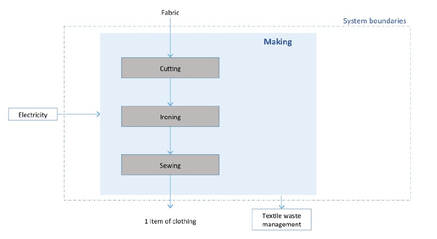

# 👗 Etape 5 - Confection

## Description

L'étape de confection a pour but de préparer et d'assembler les différentes pièces et composants afin d’obtenir le produit final. Cette étape comprend généralement la découpe du tissu, l'assemblage des différentes pièces ainsi que le repassage et pliage du produit fini.

## Modélisation Ecobalyse

### Paramètres mobilisés

Emploi matière / Chutes / Taux de perte (%)

Un taux de perte par défaut est appliqué par type de vêtement.&#x20;

Plus cette valeur est élevée, plus la quantité d'étoffe à produire est élevée.&#x20;

L'utilisateur a la possibilité de modifier ce paramètre dans le calculateur. 

Cf. l'[Explorateur](https://ecobalyse.beta.gouv.fr/#/explore/textile/products) pour les valeurs par défaut.

Electricité consommée  (MJ / kWh)

Une quantité d'électricité à mobiliser pour actionner le procédé de confection est appliquée par défaut. Cette valeur est définie selon le niveau de complexité de confection associé au vêtement.&#x20;

Cinq options sont possibles :&#x20;

* Très simple (moins de 5 minutes)
* Simple (entre 5 et 15 minutes)
* Moyen (entre 15 et 30 minutes)
* Complexe (entre 30 minutes et 1H)
* Très complexe (plus de 1H)

L'utilisateur a la possibilité de modifier ce paramètre dans le calculateur.&#x20;

Cf. la section _Hypothèses par défaut_ pour plus d'info.

Cf. l'[Explorateur](https://ecobalyse.beta.gouv.fr/#/explore/textile/products) pour les valeurs par défaut.

### Méthodologie de calcul

L'étape de _Confection_ est modélisée comme suit :

L'impact global de cette étape se comprend donc comme la somme des impacts :&#x20;

* du procédé de confection retenu (cf. intérieur du _system boundaries_),
* du procédé externe devant être ajoutés (électricité)

La formule suivante s'applique donc :

$$
ImpactConfection = ImpactProcédéConfection + ImpactElec
$$

Les **procédés de confection** utilisés dans l'industrie sont spécifiques à chaque vêtement. \
Le socle technique actuellement utilisé (Base Impacts) propose 5 procédés de confection.&#x20;


Remarque : Les coefficients d'impact des procédés de confection sont tous nuls.&#x20;


Dès lors, l'impact de cette étape se limite finalement à l'électricité nécessaire pour opérer ce processus.&#x20;

Le **procédé externe (électricité)** devant être ajouté est le suivant :

<table><thead><tr><th>Flux externe</th><th width="197.33333333333331">UUID du flux</th><th>unité</th></tr></thead><tbody><tr><td>Électricité</td><td><code>de442ef0-d725-4c3a-a5e2-b29f51a1186c</code></td><td>MJ</td></tr></tbody></table>

### Hypothèses par défaut&#x20;

#### Complexité <=> Electricité consommée <=> Vêtement

Chaque vêtement se voit attribuer un niveau de complexité (cf. [explorateur](https://ecobalyse.beta.gouv.fr/#/explore/textile/products)) en confection. \
Chaque niveau de complexité se traduit en un nombre de minutes. Le terme anglais généralement utilisé dans l'industrie pour désigner ce "temps-minute" est le Standard Minute Value (SMV) ou Standard Allowed Minute (SAM).

**0,029 kWh** d'électricité est retenue par défaut pour chaque minute de confection. Cette valeur se base sur les travaux réalisés par le programme [Mistra Future Fashion](#user-content-fn-1)[^1] (Suède). &#x20;

Dès lors, une quantité d'électricité est calculée selon le niveau de complexité de la confection.

<table><thead><tr><th width="134.33333333333331">Complexité</th><th width="206">Temps de confection</th><th width="112" align="center"># minutes</th><th>Electricité consommée (MJ / kWh)</th></tr></thead><tbody><tr><td>Très faible</td><td>Moins de 5 minutes</td><td align="center">5</td><td>0,36 / 0,1</td></tr><tr><td>Faible</td><td>Entre 5 et 15 minutes</td><td align="center">15</td><td>1,44 / 0,4</td></tr><tr><td>Moyenne</td><td>Entre 15 et 30 minutes</td><td align="center">30</td><td>3,24 / 0,9</td></tr><tr><td>Elevée</td><td>Entre 30 minutes et 1H</td><td align="center">60</td><td>6,12 / 1,7</td></tr><tr><td>Très élevée</td><td>Plus de 1H</td><td align="center">120</td><td>12,6 / 3,5</td></tr></tbody></table>


Le procédé d'électricité mobilisé s'exprime en MJ tandis que l'affichage sur le calculateur se fait en kWh car cette unité est plus communément utilisée (1kWh = 3,6MJ).


#### Délavage (jean)

Le délavage est intégré dans l'étape confection. Il s'agit d'un procédé qui s'applique après la confection et qui a un impact environnemental important. En effet le délavage demande des quantités significatives de chaleur, d'électricité et d'eau.

Il existe différents procédés de délavage dans le socle technique actuellement utilisé : \
\- mécanique ou chimique\
\- représentatif ou majorant\
\- traitement des eaux très efficace à inefficace

Pour l'instant nous ne prenons que le procédé par défaut qui est le plus impactant (chimique, majorant, traitement des eaux inefficace).&#x20;

#### Taux de perte (%)&#x20;

Un taux de perte est appliqué par défaut à chaque vêtement sur la base du socle technique ADEME et de retours métiers. L'utilisateur a la possibilité de modifier le taux de perte directement dans le calculateur entre une borne min (0%) et max (40%).

Les taux de pertes par défaut sont spécifiques à chaque vêtement (ex : 20% pour une chemise); cf. [Explorateur Produit](https://ecobalyse.beta.gouv.fr/#/explore/textile/products).&#x20;


Deux exceptions existent pour les taux de pertes:&#x20;

* &#x20;tricotage seamless = 0% (pas d'étape de confection) \
  le vêtement est fabriqué en une seule pièce sans couture lors de l'étape de tricotage
* tricotage fully-fashioned = 2% (valeur figée) \
  les différentes pièces du vêtement sont tricotées sans couture et la confection consiste "seulement" à les assembler


#### Stocks dormants&#x20;

Outre les pertes strictement liées à l'étape de confection, par exemple à travers la découpe du tissu, un pourcentage de perte est également appliqué à l'étape de confection pour traduire le fait qu'une partie de la production n'est en pratique jamais valorisée. Il s'agit des stocks dormants. Leur prise en compte est spécifiée dans la [page de la documentation dédiée aux stocks dormants](https://fabrique-numerique.gitbook.io/ecobalyse/textile/cycle-de-vie-des-produits-textiles/stocks-dormants-deadstock).

[^1]: cf. p. 49/167 de l'étude : \
    Environmental assessment of Swedish clothing consumption - six garments, sustainable futurs (2019)
